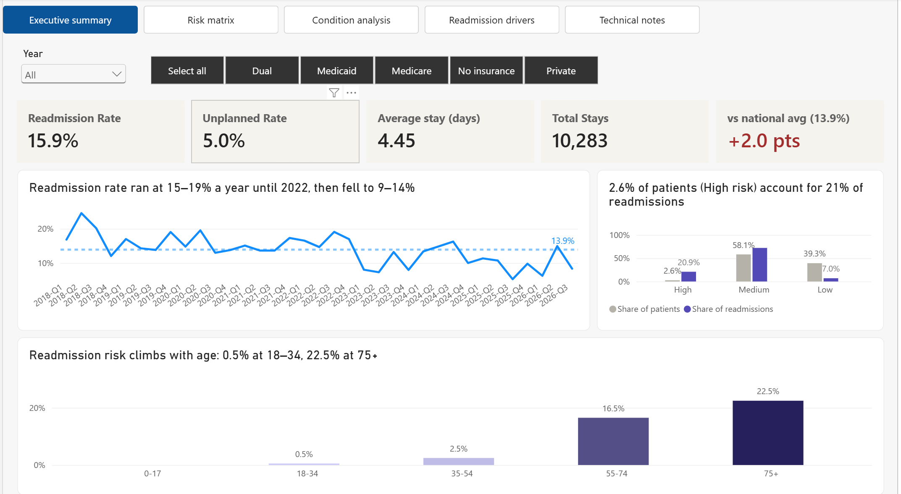
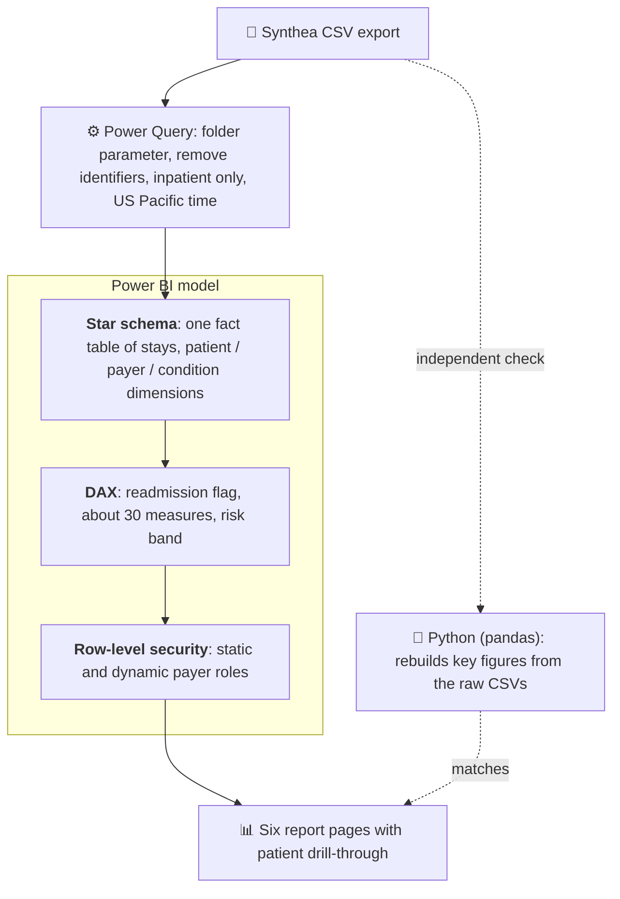
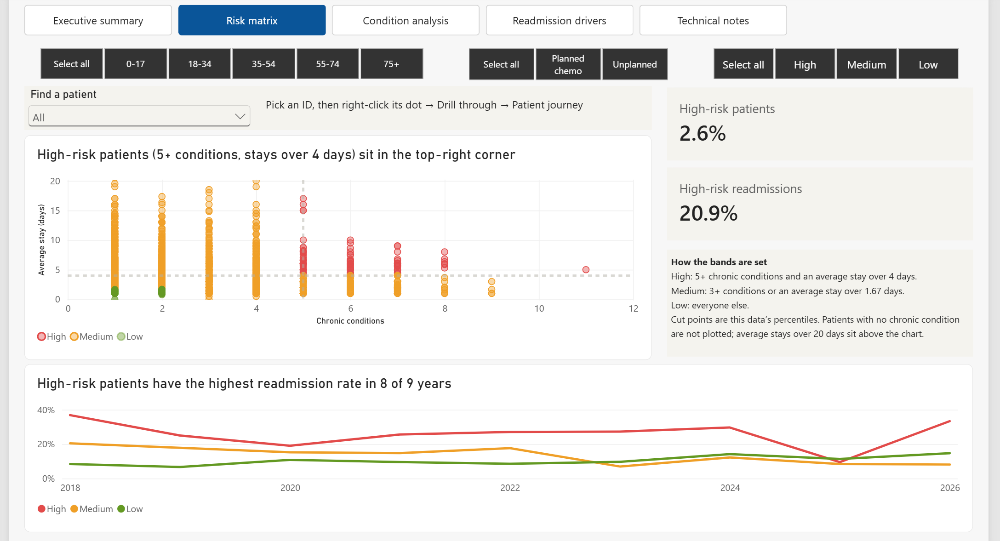
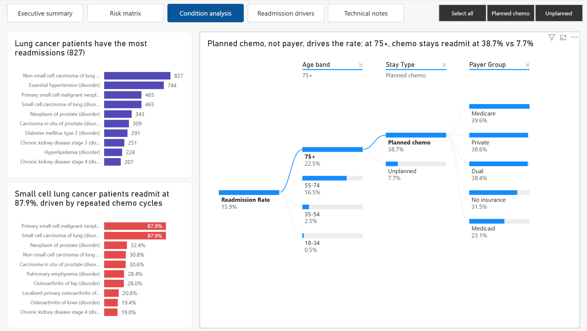
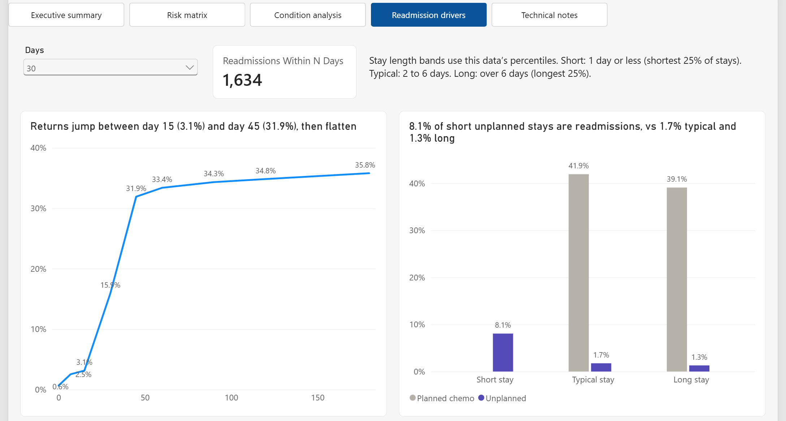
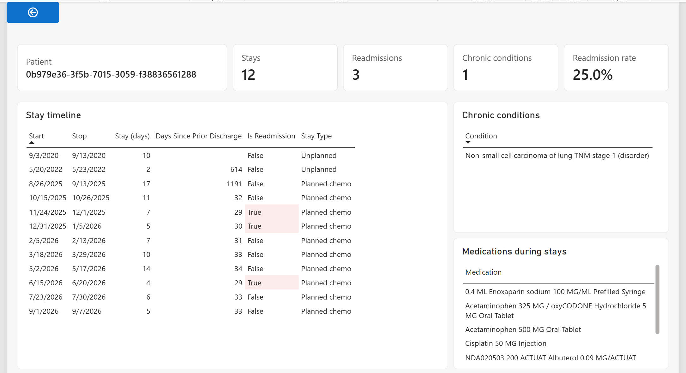

# Hospital Readmission Risk Analytics

### A Power BI report on 10,283 inpatient stays, built to answer one question: who comes back within 30 days, and where should follow-up go?

US hospitals lose Medicare payments when too many patients are readmitted within 30 days (CMS Hospital Readmissions Reduction Program), so the readmission rate is a number with a cost attached. The obvious reading of that number is misleading here: most "readmissions" in this data are scheduled chemotherapy cycles, not patients who got worse after going home.

**The headline 15.9% rate is mostly planned chemo; the unplanned rate is 5.0%. A risk band built on condition count and stay length looks strong, but most of its readmissions are those chemo cycles: among unplanned stays it holds only 3.0% of readmissions.**




---

## The data

| | |
|---|---|
| **Source** | [Synthea](https://github.com/synthetichealth/synthea) (MITRE's open-source synthetic patient generator), CSV export |
| **Licence** | Apache License 2.0. Every patient is synthetic, so there is no personal health information and the data is safe to publish |
| **Period** | Encounters from 1924 to 22 September 2026; trend charts start in 2018 because earlier years are sparse |
| **Size** | 10 CSV tables · 671,641 encounters · 11,438 patients (plus 415,651 condition and 564,381 medication records) |
| **Nature** | A fixed, one-off export, not a live feed |

Each patient is simulated from birth through disease modules, so every encounter, diagnosis and prescription is a side effect of that simulation.

### How the counts narrow

| Population | Stays | Why it narrows |
|---|---|---|
| All encounters | **671,641** | — |
| Inpatient stays | **10,283** | Emergency, outpatient, wellness, SNF, home health and hospice visits are not admissions, so a return to them is not a readmission |
| Unplanned stays | **7,168** | 3,115 stays (from 94 patients) are scheduled lung-cancer chemotherapy |
| Readmissions (all-cause) | **1,634** | Stays that start within 30 days of the same patient's previous discharge |
| Unplanned readmissions | **361** | The other 1,273 readmissions (78%) are chemo cycles |

The 10,283 stays belong to 3,874 patients. Rates below are per stay unless they say "of patients".

---

## Architecture



Power Query is the cleaning layer, the star schema and DAX are the model layer, and the report pages are the presentation layer.

### Why split planned chemo, not report one rate

**Separate planned from unplanned.**

Reported as a single number, the 15.9% rate would point follow-up at cancer patients who were coming back on schedule. Flagging the 3,115 chemo stays shows the unplanned rate is 5.0% and moves attention to the patients who actually return unexpectedly. CMS's own readmission measures exclude planned readmissions for the same reason.

---

## The data model

The raw CSVs become a star schema with one row per inpatient stay, so every measure counts stays the same way.

```
   dim_patients        dim_payers         dim_conditions
         │                  │                   │
         │                  │            bridge_conditions
         └──────────────────┼───────────────────┘
                            ▼
                    ⭐  fact_encounters
              one row per inpatient stay (10,283)
      dim_date (admission, active) · dim_date_discharge (inactive)
                            │
                            ▼
          fact_medications · fact_procedures (linked to stays)
```

All relationships are single-direction. Where a filter has to cross the bridge, specific measures do it with `CROSSFILTER` or `TREATAS`, which keeps filters predictable and row-level security clean. `dim_user_access` maps a sign-in email to a payer for the dynamic security role (all emails are placeholders). [Model diagram](screenshots/07-data-model.png)

### Three grain decisions

**Inpatient stays only.** Synthea records 671,641 encounters, but a follow-up clinic visit or a move to rehab is not a readmission. Counting every encounter would produce a rate with no clinical meaning; keeping the 10,283 inpatient stays follows CMS practice.

**Fix the time zone.** Synthea stores timestamps in UTC, and Power BI converted them to my local time (US Pacific). That shifts a few stays across midnight, enough to change a day count: 1,634 readmissions in Pacific time against 1,628 in UTC. I kept Pacific time and made the Python check use the same zone, so both give 1,634.

**Chronic conditions only.** Counting every recorded condition gives 20 to 58 per patient, which cannot separate high-risk patients from anyone else. Restricting to 36 chronic condition codes (of 304) gives a count that rises cleanly with risk, from 2.0% with none to 22–23% with three to five.

**Key DAX: the readmission flag** (calculated columns on `fact_encounters`)

```dax
Days Since Prior Discharge =
VAR CurrentStart = fact_encounters[START]
VAR PriorStop =
    CALCULATE(
        MAX( fact_encounters[STOP] ),
        ALLEXCEPT( fact_encounters, fact_encounters[PATIENT] ),
        fact_encounters[STOP] < CurrentStart
    )
RETURN
    IF( ISBLANK( PriorStop ), BLANK(), DATEDIFF( PriorStop, CurrentStart, DAY ) )

Is Readmission =
NOT ISBLANK( fact_encounters[Days Since Prior Discharge] )
    && fact_encounters[Days Since Prior Discharge] <= 30
```

**Key DAX: the risk band** (calculated column on `dim_patients`; cut-offs are this data's 95th and 75th percentiles of chronic conditions and the 75th percentile and median of average stay)

```dax
Risk Band Sort =
SWITCH(
    TRUE(),
    ISBLANK( dim_patients[Patient Avg LOS] ), 4,
    dim_patients[Chronic Conditions] >= 5 && dim_patients[Patient Avg LOS] > 4, 1,
    dim_patients[Chronic Conditions] >= 3 || dim_patients[Patient Avg LOS] > 1.67, 2,
    3
)
```

---

## Stack

| Function | Tools | Detail |
|---|---|---|
| **Ingestion and cleaning** | Power Query | Folder parameter so the data path can change; SSN, driver's licence and passport numbers removed on load |
| **Model** | Power BI | Star schema, bridge table for the many-to-many patient–condition link, two calendars for admission and discharge dates |
| **Measures** | DAX | About 30 measures in display folders: KPIs, benchmark gap, same period last year, month on month, percentile thresholds, readmissions within N days |
| **Security** | Row-level security | Static roles (Medicare Analyst, Medicaid Analyst, Executive) and a dynamic role using `USERPRINCIPALNAME` |
| **Validation** | Python (pandas) | Rebuilds the readmission flag, stay lengths, planned chemo and risk bands from the raw CSVs; every key figure matches the report |
| **Optimisation** | Power BI | File reduced from 86 MB to 9.6 MB by limiting procedures and medications to inpatient stays |

---

## Repo layout

```
├── README.md
├── Readmission_Analytics.pbix      the Power BI report
├── screenshots/                    one PNG per page, plus the data model
└── scripts/readmission_eda.py      raw-data validation script
```

Open the `.pbix` to see the report, and `scripts/readmission_eda.py` to see how the figures were checked independently.

---

## Running it

**To view the report**, open `Readmission_Analytics.pbix` in Power BI Desktop (free). In Desktop, hold Ctrl when clicking the page buttons.

**To re-run the validation**, generate a Synthea population with the CSV exporter switched on (the raw CSVs are not in this repo because of their size), then:

```
pip install pandas
python scripts/readmission_eda.py "path/to/synthea/csv"
```

---

## What it found

**The headline rate is mostly planned care.**

| | Stays | Readmissions | Rate |
|---|---|---|---|
| Planned chemo | 3,115 | 1,273 | **40.9%** |
| Unplanned | 7,168 | 361 | **5.0%** |
| All stays | 10,283 | 1,634 | **15.9%** |

The national benchmark of 13.9% (AHRQ HCUP Statistical Brief #304) also counts planned returns, so 15.9% is the fair comparison: 2.0 points above. Because 78% of readmissions here are chemo cycles, that gap says more about how Synthea simulates chemotherapy than about quality of care. Taking the chemo out leaves an unplanned rate of 5.0%. Both views use the same stays.

### Payer is a proxy for age and treatment

Medicare looks almost three times worse than private insurance (23.5% vs 8.6%; "private" groups the six commercial insurers: Aetna, Anthem, Blue Cross Blue Shield, Cigna, Humana and UnitedHealthcare). Held to the same age and treatment, the gap disappears:

| 75+ and planned chemo | Rate |
|---|---|
| Medicare | 39.6% |
| Private | 38.6% |
| Dual eligible | 38.4% |
| No insurance | 31.5% |
| Medicaid | 23.1% |

Medicare and private patients have almost the same rate once age and stay type are held equal. The Medicaid row rests on only 26 stays, so its lower rate is too thin to act on.

### The recommendation

Report the unplanned rate next to the all-cause rate, and don't use the High-risk band to decide who gets a follow-up call: with chemo removed, it holds only 3.0% of unplanned readmissions. Aim follow-up at the groups with the highest unplanned rates instead: patients aged 75+ (7.7%), with Alzheimer's (9.2%) or a prior heart attack (7.4%). This is a change to how the number is reported and who gets a call after discharge, not an investment in new systems. Insurance type should not be used as a risk flag either; age and treatment explain the gap.

### The other findings

| | |
|---|---|
| **H1: more chronic conditions, more risk (supported)** | 2.0% with none, 22–23% with three to five. High-risk patients are 2.6% of patients (about 100 people) but 20.9% of readmissions (32.2% vs 5.5% for Low). Most of that is chemo: among unplanned stays, High-risk patients hold only 3.0% of readmissions. |
| **H2: short and long stays are riskier (not supported)** | Among unplanned stays, the chance of an unplanned return is similar whatever the stay length: 4.7% short, 5.8% typical, 3.8% long. |
| **H3: some conditions carry more risk (supported, reworded)** | Cancers lead because of chemo cycles. With planned care removed, Alzheimer's (9.2%) and prior heart attack (7.4%) have the highest unplanned rates. |
| **H4: risk differs by age and payer (age supported; payer explained)** | 0.5% at 18–34 to 22.5% at 75+. The payer gap is explained by age and treatment (above). |
| **H5: returns cluster at a point (supported)** | About 3% of stays return by day 15, 32% by day 45, then the curve flattens. The 30-day window cuts through the chemo cycle. |

Five hypotheses, written down before building, each tested on a report page.

### On the report

The Executive summary shows the all-cause and unplanned rates, the benchmark gap, a trend line and the risk-band and age splits. Risk matrix plots patients with at least one chronic condition by condition count and stay length, with a patient search that drills through to that patient's full history. Condition analysis and Readmission drivers test H3 to H5, and Technical notes lists the definitions and data quirks ([screenshot](screenshots/06-technical-notes.png)).

| | |
|---|---|
|  |  |
|  |  |

---

## What building it taught me

**The 30-day rule can split identical care.** One patient's chemo cycles fall 29 to 34 days apart, so of ten almost identical chemo stays, three count as readmissions and seven do not. That patient shows why planned care has to be separated rather than reported as one rate.

**Check which side of the stay a flag sits on.** My first stay-length result looked like support for H2, but the readmission flag sits on the later stay, so the chart described the readmissions themselves. Measured from the first stay's side, stay length does not predict an unplanned return, and I changed H2 to not supported.

**Test a risk score on the outcome you want to prevent.** The High-risk band looked strong: 2.6% of patients, 20.9% of readmissions. Filtered to unplanned stays, its share fell to 3.0%, because most of the band's readmissions came from the chemo patients inside it, whose returns are scheduled. Asking who the band really catches is what found it.

**A hypothesis can be wrong and still be useful.** H3 started as "condition pairs carry extra risk". Across 39 pairs, patients with both conditions were not consistently readmitted more often than with either one alone, so I reworded it to single conditions, which the data does support.

**Data issues found along the way:** 223 stays start before the previous stay ended, so they cannot be readmissions, and 66 start on the day of the previous discharge. Some open stays are stamped with the export time, which inflates their length. Most payer-history rows are annual renewals, not real changes of insurer.

---

## Limits and what comes next

| Limit | Why | Next |
|---|---|---|
| **Synthetic data** | Synthea models disease progression, not quality of care, so real causes such as discharge planning and missed follow-up are barely present | Re-run the same model on real or de-identified hospital data; the benchmark comparison stays illustrative until then |
| **Rule-based flags** | Planned chemo is stays whose reason mentions lung cancer; chronic conditions are a keyword list (36 of 304 codes) | Replace with CMS's planned-readmission algorithm and a standard comorbidity index (Charlson or Elixhauser) |
| **Descriptive, not predictive** | The risk band describes who was readmitted; it has not been tested as a forecast | Rebuild the band on unplanned readmissions only, then test it as a forecast on a held-out period |
| **Static snapshot** | One export with no scheduled refresh; shared as a `.pbix` and screenshots rather than a live link | Publish to the Power BI service with a scheduled refresh once there is a live source |
| **Chart titles under security roles** | Titles are fixed text, so under a payer role the numbers change but the titles still describe the full dataset | Make the titles dynamic with a DAX measure |

---

## Built by

**Hannah** · [GitHub](https://github.com/hannah-vp)

---

*Every figure here was computed in the Power BI model and checked against the raw data with the script in this repo. Data generated with [Synthea](https://github.com/synthetichealth/synthea) (MITRE), Apache License 2.0.*
